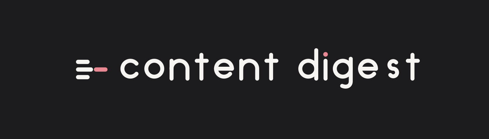
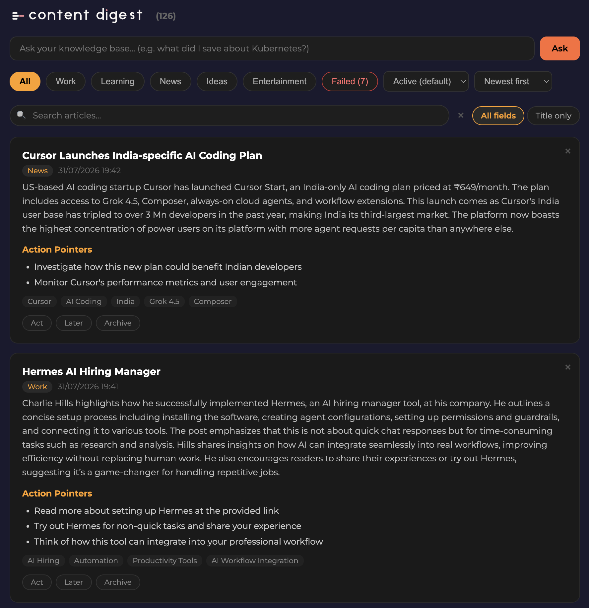
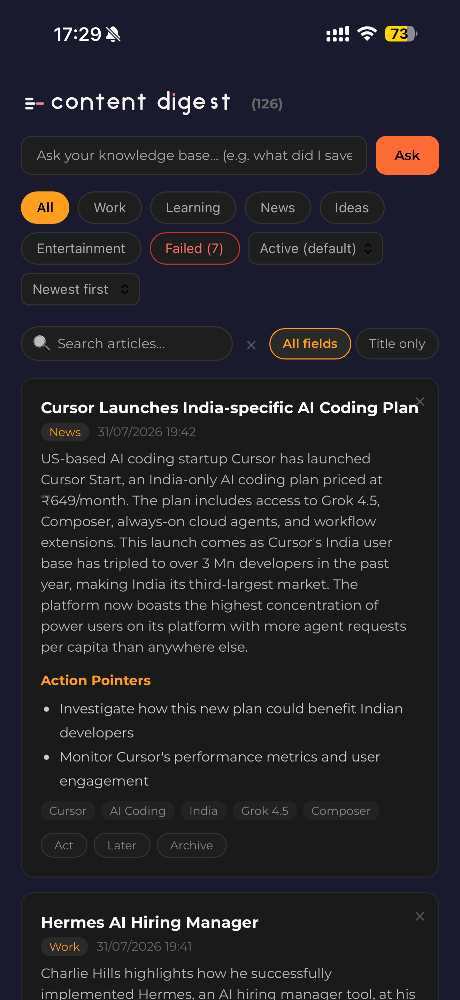
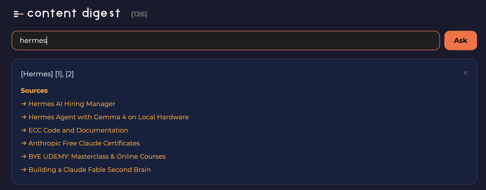
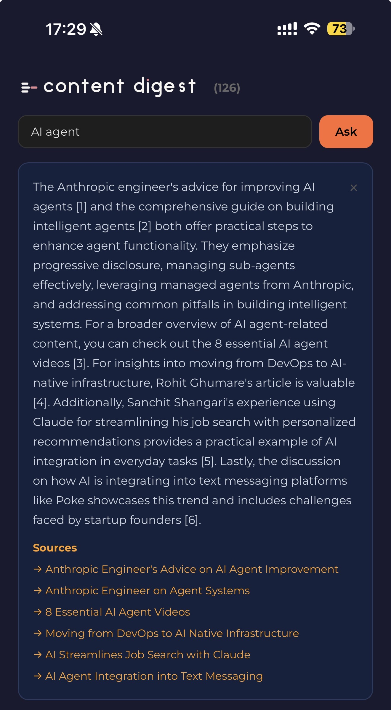
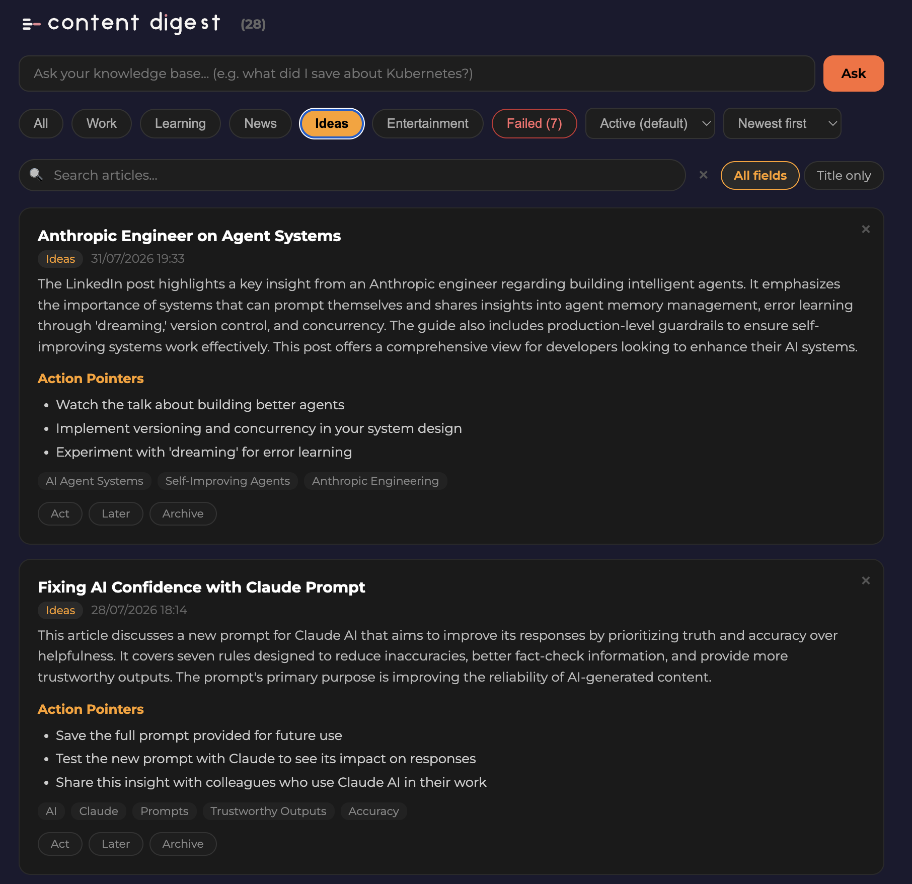
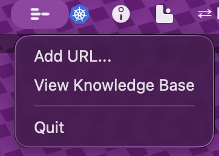
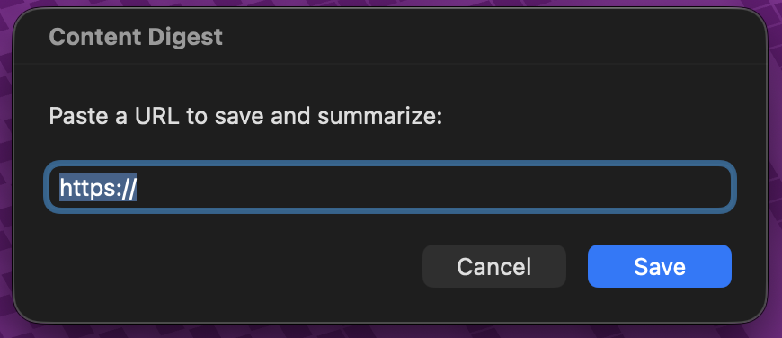

<p align="center">
  <picture>
    <source media="(prefers-color-scheme: dark)"  srcset="design/github/readme-banner-dark-1400x400.png">
    <source media="(prefers-color-scheme: light)" srcset="design/github/readme-banner-light-1400x400.png">
    
  </picture>
</p>

<h1 align="center">Content Digest</h1>

<p align="center"><b>Saves anything you find, summarizes it with a local LLM, and turns it into a knowledge base you can question.</b></p>

<p align="center">
  
  
  
  
  <a href="LICENSE"></a>
</p>

## What it does

- Saves a URL from the Mac menu bar, the iPhone share sheet, a Chrome extension, or a Shortcut.
- Summarizes each item in 150 to 200 words with action pointers, using a local model.
- Categorizes and tags every item automatically.
- Answers plain-language questions about everything you have saved.
- Emails a slim morning brief of the last day's saves.
- Keeps storage and summarization on your own machine: summaries and answers come from a local model only.

## Features

### Capture

- **Menu bar capture.** Click the icon, paste a URL, get a summary in seconds.
- **iPhone share sheet.** A Shortcut posts to the server's authenticated endpoint.
- **Chrome extension.** Click the icon, paste the exact URL, send. The popup reports honestly whether the item was saved, already saved, queued for retry, refused, or failed, and links straight to the knowledge base. Saving the current page with its rendered text (for logged-in-only pages such as Reddit and LinkedIn) and right-click capture remain as optional conveniences.
- **Inbox capture before auth.** URLs are logged to `inbox.json` before the auth check so a rejected request is still visible for review, but only authenticated entries are ever re-queued for processing.
- **Self-healing capture.** Fetch failures retry 10 minutes after the server starts and every 6 hours after that, up to 3 attempts; inbox URLs that never became items are re-queued on the same sweep.
- **URL normalization.** Tracking parameters (`utm_*`, `fbclid`, `share_id`, `si`) are stripped before dedupe and storage.
- **Canonical URL dedupe.** The same article saved twice stays one item.

### Extraction

- **Source-aware extractor registry.** Per-source handlers rather than one parser for everything.
- **Reddit without API approval.** Threads and top comments from old.reddit.com, with the arctic-shift archive as automatic fallback.
- **YouTube transcripts.** Pulled via `youtube-transcript-api`.
- **X posts.** Fetched through fxtwitter.
- **Everything else via trafilatura.** Replaced the original regex extraction and made summaries materially cleaner.
- **Reader-proxy fallback.** Blocked sites route through a reader proxy instead of failing.
- **Fetch failure guard.** If extraction fails, the model is never called and you get a clear notification instead of a fabricated summary.

### Knowledge base

- **Ask your knowledge base.** A question box over your own saved items, using local Ollama embeddings (`nomic-embed-text`) with keyword fallback, answering with cited sources.
- **Everything in one view.** Every saved item shows; nothing is archived or hidden on its own.
- **Categories.** Work, Learning, News, Ideas, Entertainment, and Tool: a tool, app, repo, extension or product someone built and linked. One tap on a category filters the base.
- **Search and sort.** Full-text search with date and time on every card.
- **Persistent delete.** Removing an item removes it from storage, not just the view.
- **LLM output validation.** Category whitelist, relevance bounds, and shape checks before anything is saved.

### Daily brief

- **Slim morning email.** Sent at the time of the LaunchAgent that runs `daily_brief.py`: every save from the last 24 hours, newest first, each with its title (linked to the item), its category and a two-line summary. Nothing else: no backlog items and no triage links.
- **Host-health warning.** The brief adds one warning line when saves or authenticated client contact stop for 48 hours.

### Health

- **Runtime watchdog.** The server writes `heartbeat.json` every 5 minutes and records the last authenticated contact per client (`X-Client` header) in `clients.json`; `/health` reports version, start time, last save, last client contact and the failure count, and the server log carries a content-free line per request (method, path, status, client; never the URL or a token). The Mac menu bar client polls `/health` every 15 minutes with no credentials, shows the result in its menu, and after two consecutive misses posts one banner and puts a `!` beside its icon until the server answers again.

### Model routing

- **Local only.** Ollama on the server machine writes every summary and answers every Ask question. There is no cloud fallback: when the local model is down, a save becomes a visible failure and the retry sweep tries it again later.

## Stack

- App: Python, rumps menu bar client
- Extraction: trafilatura, youtube-transcript-api
- Local inference: Ollama (no cloud model)
- Storage: plain JSON, plain HTML knowledge base
- Capture surfaces: iOS Shortcuts, Chrome extension (Manifest V3)

## Install

Requires: Python 3.11 or later, Ollama running locally, Homebrew.

```bash
git clone https://github.com/ShashankKarpal/content-digest-app.git
cd content-digest-app
pip3 install -r requirements.txt --break-system-packages
ollama pull qwen2.5:3b              # the summarizer
ollama pull nomic-embed-text        # optional, enables semantic ask
python3 server.py                   # the server (port 7778)
python3 client.py                   # optional: the menu bar client
```

## Configuration

Copy `secrets.example.json` to `secrets.json` and fill it in. `secrets.json` and `config.json` are gitignored and never committed.

```json
{
  "auth_token": "YOUR_TOKEN_HERE",
  "smtp_user": "YOUR_EMAIL_HERE",
  "smtp_password": "YOUR_APP_PASSWORD_HERE",
  "recipient": "YOUR_EMAIL_HERE"
}
```

Set the server address in `local_settings.py` (also gitignored) as `SERVER = "http://..."`. That file is read by the menu bar client only; the server ignores it, so an `OLLAMA_URL` there does nothing (Ollama is always `localhost:11434` on the machine that runs `server.py`). Never commit a LAN, tailnet, or VPN address.

The daily brief reads SMTP settings from `config.json` (gitignored): `smtp_user`, `smtp_password`, `recipient`. Any other key is ignored (an old `server_base` does nothing now that the brief carries no triage links); the send time is set by the LaunchAgent that runs `daily_brief.py`, not by the file. Act / Later / Archive links in briefs sent before the change open a short "this link has been retired" page and change nothing.

Real credentials live only on local machines. Nothing in this repository holds a working secret.

## Network exposure

The server binds `0.0.0.0:7778` but refuses any connection that does not come from loopback, an RFC1918 private range, or the Tailscale CGNAT block (100.64/10). Every POST endpoint, including `/delete` and `/ask`, requires the bearer token or a valid session cookie, and the knowledge base at `/view` is locked behind a one-time unlock per browser: the Locked page asks for the token once and sets a year-long session cookie (the token itself is never stored in the browser, and since 2026-09-05 the menu bar client opens plain `/view` rather than putting the token in the URL). Placeholder token values are treated as no token at all: the server rejects everything until a real random token is set.

Optional explicit bind (off by default): add `"bind_addresses": ["127.0.0.1", "100.x.y.z"]` to `config.json` and the server listens on exactly those addresses instead of `0.0.0.0`, so traffic from any other interface is refused by the kernel before the allowlist is even consulted. Each address is retried for up to two minutes at startup because a tailnet address can appear a few seconds after login; an address that never binds is skipped, and if none binds the server falls back to `0.0.0.0` with a warning so capture stays up. List your home LAN address too if the phone saves over Wi-Fi.

Still: do not port-forward this, and prefer a tailnet (Tailscale) for remote access. There is no TLS; on a hostile local network, traffic is readable in transit.

## Usage

**iPhone Shortcut.** One Shortcut called Save to Content Digest, offered in the share sheet. Five actions:

1. Receive input from Share Sheet (URLs; if there is no input, Continue).
2. URL: `http://YOUR_SERVER:7778/add_sync` (your tailnet or LAN address).
3. Get Contents of URL: Method POST; Headers `Authorization: Bearer YOUR_AUTH_TOKEN` and `X-Client: shortcut`; Request Body JSON with one key `url` set to Shortcut Input. `/add_sync` waits for the result (a slow page can take a minute or two), so the next step can say what really happened.
4. Get Dictionary Value `status` from Contents of URL.
5. Show Notification with that value: `saved`, `already_saved`, `failed`, or `invalid`.

If the server cannot be reached at all (phone off the tailnet, host down), Shortcuts stops with its own error, which is the loud failure you want. The `X-Client` header is optional; it lets the server count the phone as a live client for the host-health line.

**Chrome extension.** Open `chrome://extensions`, enable Developer mode, Load unpacked, select `extension/`. Set your server URL and auth token in the extension options, then use Test connection. Clicking the toolbar icon opens a popup with an empty URL field: paste the exact URL you want summarized and click Send to Content Digest. The popup immediately says the item was sent and Content Digest is working on it, then reports the real outcome: saved, already saved, queued for retry (server unreachable or token rejected; nothing is discarded), refused, or failed. The summary normally appears in Content Digest within about a minute, depending on the server. Open Content Digest jumps to the knowledge base. Save current page and the right-click Save to Content Digest menu are optional conveniences; on LinkedIn the right-click path uses LinkedIn's own Copy link to post action to find the post permalink. Feed and container pages such as `linkedin.com/feed/` are refused rather than saved as items. Upgrades preserve the existing local settings and keep the one-time 0.5.1 purge of Chrome's synced copy.

## Project structure

```
server.py         HTTP server: extraction, summarization, knowledge base
client.py         menu bar client (sends URLs to the server)
extractors.py     per-source extractor registry
daily_brief.py    slim morning email brief
migrations.py     one-time data migrations, run by the server at start-up
extension/        Chrome extension
design/           brand assets, tokens, BRAND.md
docs/             product intent, roadmap, decision log, worklog, audits
tests/            unit tests (python3 -m unittest discover tests) and the extension acceptance suite (node tests/extension_acceptance.test.js)
screenshots/      UI screenshots
```

## Screenshots

**Knowledge base on Mac.** Every saved link lands here summarized, with action pointers and auto-tags. (Screenshot taken before 2026-10; the Act / Later / Archive buttons it shows are retired.)



**Knowledge base on iPhone.** The same view from Safari on iOS; add it to the home screen and it opens like a native app.



**Ask your KB.** Natural-language questions answered from saved items only, with cited sources. On Mac and iPhone.





**Category filters.** One tap isolates a category; here, everything saved as an Idea.



**Capture from the menu bar.** The brand icon lives in the Mac menu bar; Add URL takes a link, the pipeline does the rest.

| Menu bar | Add URL |
| --- | --- |
|  |  |

## Roadmap

| Version | Goal | Status |
|---|---|---|
| v0.1 | Frictionless capture and trustworthy summaries | Shipped |
| v0.2 | Return loop: digest email and item states | Shipped |
| v0.3 | Search, timezone-aware timestamps, reader-proxy fallback | Shipped |
| v0.4 | Reddit, extractor registry, ask-your-KB, Chrome extension | Shipped |
| v0.5 | Close the loop: auth everywhere, resurfacing brief, one-tap triage, triage deck, auto-archive decay | Shipped |
| v1 | Personalization: surface content based on what you act on | Data-gated: needs real act/archive signal first |

## Deployment

The always-on M1 is the runtime host. It runs a git clone of this repo at `~/content-digest-app` plus an auto-deploy agent (`com.shashank.autodeploy`, every 15 minutes since 2026-08-18; earlier docs said 5): fetch origin, hard-reset to the upstream branch on change, `py_compile` sanity check, then restart the server LaunchAgent. A failed compile logs to `~/autodeploy.log` and leaves the running service untouched. Any commit restarts the server, including documentation-only ones.

To ship: commit and push to GitHub from the dev machine. Never edit code on the M1; the next deploy cycle overwrites it by design. Runtime data (`knowledge.json`, `secrets.json`, and friends) is gitignored and survives deploys.

## Known limitations

- The local model must be reachable for summarization; while it is down, saves wait in the failures list and are retried.
- The Mac address changes across networks; update the iPhone shortcut if capture stops working.
- YouTube videos without transcripts hit the fetch failure guard rather than guessing from the title.
- LinkedIn saved-post harvesting is not built; the Chrome extension captures one post at a time by right-click or pasted permalink.
- No TLS; see Network exposure above.

## Privacy

Saved items, summaries, embeddings, and the knowledge base live in plain files on your own machine, and only a local model ever reads the text of what you save. Two things leave the machine: fetching the pages you save (blocked sites route via the reader proxy), and the morning brief email over SMTP. Leave the SMTP settings out of `config.json` and no brief is sent.

## License

MIT. See [LICENSE](LICENSE).

## Author

Built by Shashank Karpal, with credit to u/sunlesshalo and Karl for the original idea.

> Designed and built with Claude (Anthropic).
